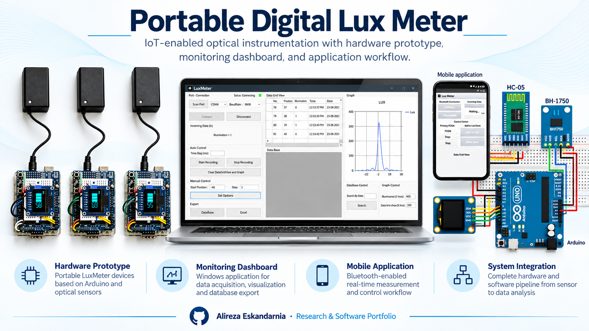
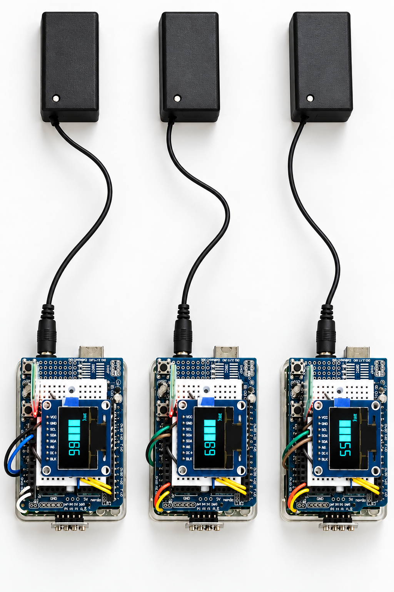
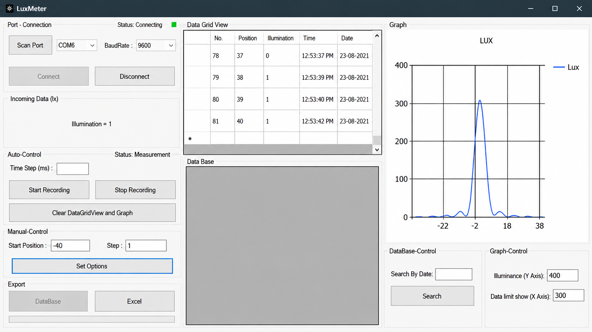
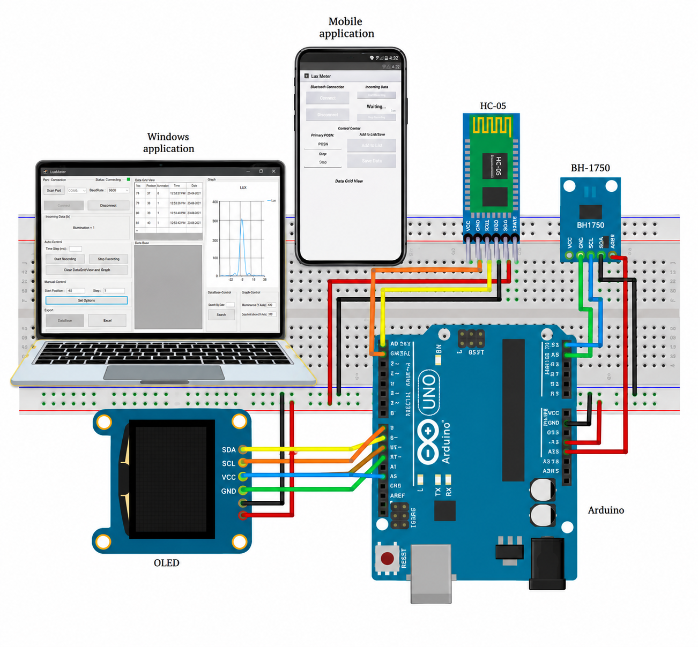

<!-- Academic and software portfolio showcase. No source code is included. -->
# Portable Digital Lux Meter — Optical Instrumentation & IoT

**Optical Instrumentation · Illuminance Measurement · Arduino · C# · Data Acquisition**

An undergraduate optical-instrumentation project involving the design and construction of **three portable digital lux-meter prototypes** and associated measurement and monitoring interfaces.

## Hardware Prototypes

The work integrates a microcontroller, illuminance sensing, local display, and a portable device enclosure. The shown system architecture includes an **Arduino**, **BH1750 light sensor**, **OLED display**, and **HC-05 Bluetooth module**.

## Measurement Software

A **C# Windows application** was developed for serial-port connection, live illuminance readings, data logging, tabular visualization, plotting, and data export. The project material also illustrates a mobile interface for Bluetooth-enabled monitoring and control.

## System Integration

**Technical areas:** Optical sensors, embedded systems, Arduino prototyping, C# desktop software, serial communication, data visualization, and Bluetooth-enabled IoT interfaces.

**Scope:** This repository documents the project through visuals. It does not include firmware, application source code, hardware design files, or independently verified measurement accuracy data.

---

**Researcher:** Alireza Eskandarnia  
[GitHub](https://github.com/aalirezaaes) · [ORCID](https://orcid.org/0009-0009-2584-9063) · [LinkedIn](https://www.linkedin.com/in/alireza-eskandarnia/)

**Availability:** Portfolio documentation and selected visual material only. Source code and datasets are not included. No open-source license is granted by this repository.
